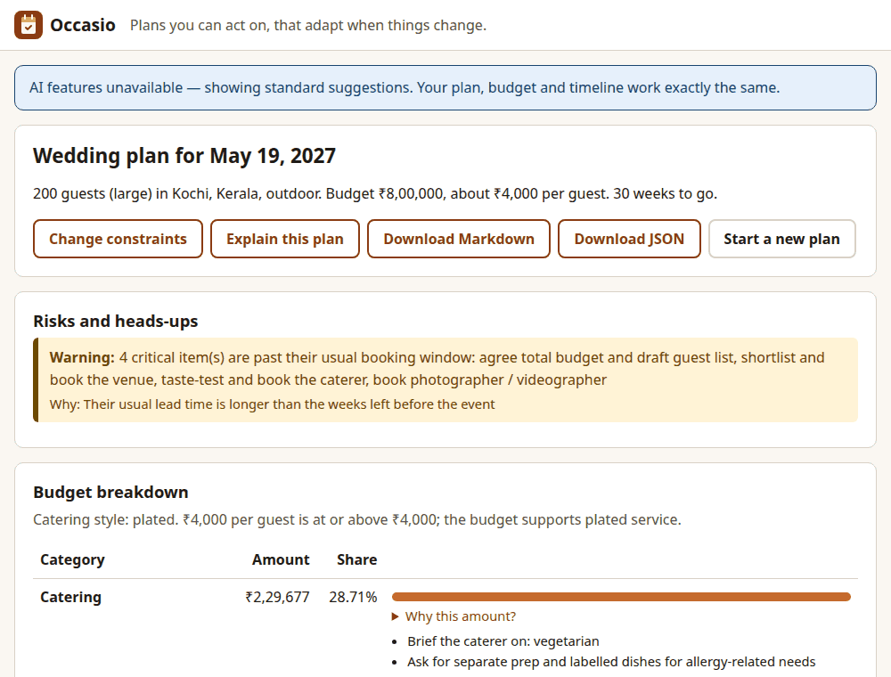
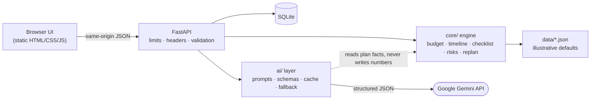

# Occasio — GenAI event planning assistant

Occasio turns a few facts about an event (type, date, guests, budget, place, preferences)
into a plan you can act on: a budget split, a milestone timeline worked back from the date,
a vendor checklist, risk flags and personalised ideas. When something changes ("the budget
dropped 20%", "the guest list grew to 180") it re-plans and shows exactly what moved.
A **deterministic rules engine** makes every decision about money, dates and tasks; **Google Gemini**
only handles language. It runs fully without an API key.



---

## 1. Chosen vertical and persona

**Vertical:** event and celebration planning. Weddings, birthdays, and community events
such as fundraisers, cultural festivals and neighbourhood meetups.

**Persona: Anu, a first-time planner.** She has an event type, a date, a rough guest count,
a budget ceiling, a location and some preferences (vibe, dietary needs, must-haves). She does
not know what a realistic budget split looks like, what to book first, or what she is
forgetting. She wants a plan she can act on, and she wants it to adapt when things change.

## 2. Approach and logic

### Hybrid architecture

| Layer | Responsibility | Why |
|---|---|---|
| **Deterministic engine** (`src/occasio/core/`, pure Python, no LLM, no network) | Budget allocation, timeline built back from the date, checklist by event type and scale, feasibility and risk checks, re-planning with a diff | Repeatable, testable, auditable, free and offline. All of the *decision making* happens here. |
| **GenAI layer** (`src/occasio/ai/`, Google Gemini with JSON-schema structured output) | Free text → form fields, personalised theme/menu/decor ideas, plain-language explanation of the engine's decisions | Plays to what LLMs are good at: language, creativity, mapping messy input to structure. |

The LLM **never decides the numbers.** Every budget line, milestone, task and risk has a
`reason` string. The UI shows these reasons ("Why this amount?"), and they are also the only
facts the explanation prompt receives.

### Decision rules

| Rule | Trigger | Effect | Reason (example) |
|---|---|---|---|
| Base split | Event type | % per category from `data/budget_splits.json` | "Base share for a wedding: 30%" |
| Catering style | Budget per guest vs per-currency thresholds × regional cost multiplier | Plated / buffet / potluck (potluck only for community events; it frees 60% of catering for contingency) | "₹4,000 per guest is at or above ₹4,000; the budget supports plated service" |
| Sound & AV | Guests **> 150** | +4% `sound_av` line and a critical AV task | "200 guests (> 150) need amplified sound and AV" |
| Monsoon contingency | Outdoor/mixed + location's monsoon month | +10 points contingency, critical weather-backup task, warning | "outdoor event in July, monsoon season for India" |
| Lead-time class | Weeks to event | comfortable ≥ 16 · tight 6–16 · crisis < 6 | "5.9 weeks to go (< 6): crisis mode…" |
| Timeline compression | Usual lead time > time left | Milestones are scaled into the window in the same order, and late ones are flagged **Book now** | "Usually done 44 weeks before…; that date has passed" |
| Crisis triage | Crisis lead time | Non-critical milestones become optional | "skip if it competes with critical items" |
| Scale | Guest count | small < 50 · medium 50–150 · large > 150 → scale-specific tasks | "Standard for a large (> 150 guests) wedding" |
| Sponsorship | Community event, no ticket revenue | Critical sponsorship task + note | "budget must be covered by sponsors or grants" |
| Dietary | Any dietary flag | Catering notes + caterer-brief task | "Guests need vegan, jain options" |
| Re-plan follow-ups | Budget cut ≥ 10%, guests grow, or date moves **after** bookings | Renegotiate, confirm capacity, or notify vendors | "Budget dropped 20% after some vendors were booked" |

The full table and module boundaries are in [`docs/architecture.md`](docs/architecture.md).



## 3. How it works

1. **Intake.** Fill the form, or describe the event in words and press *Autofill*. With AI
   on, Google Gemini extracts the fields against a JSON schema. With AI off, a regex parser does a
   best-effort job ("200 people, December, Kochi, ~8 lakh" works). Budget and date always come
   back as `suggested_*` values, are highlighted, and must be confirmed by the user.
2. **Plan.** `POST /api/plans` validates the profile and runs `build_plan()`: knowledge tables
   → budget rules → timeline → checklist → risks. The result is stored in SQLite.
3. **Ideas / explanation.** The server sends Google Gemini only engine facts (`<plan_facts>`) and the
   user's own text inside `<user_data>` delimiters. The reply is validated by Pydantic
   (`extra="forbid"`, length limits). The explanation is rejected if it contains any number
   that is not already in the plan.
4. **Re-plan.** `POST /api/plans/{id}/replan` with a partial profile → new plan, checklist
   progress carried over, follow-up tasks, and a structured diff ("Decor reduced ₹1,00,000 →
   ₹80,000", "New task: Confirm the venue can hold 140 guests").
5. **Export.** Markdown or JSON download.

**Fallback behaviour.** The AI client returns `None` when there is no key,
`OCCASIO_AI_ENABLED=false`, a timeout, an API error, a refusal, truncation, non-JSON output,
or a schema violation. Each feature then uses `ai/fallback.py`, which builds template ideas
and explanations from the engine's `reason` fields. Responses carry `"source": "ai"` or
`"source": "fallback"`, and the UI shows "AI features unavailable — showing standard
suggestions" when `/healthz` reports AI disabled.

### API

| Method | Path | Purpose |
|---|---|---|
| `POST` | `/api/plans` | Profile → plan (201) |
| `GET` | `/api/plans/{id}` | Fetch a stored plan |
| `POST` | `/api/plans/{id}/replan` | Partial profile → new plan + diff |
| `PATCH` | `/api/plans/{id}/tasks/{task_id}` | Tick a checklist item (`todo`/`done`) |
| `GET` | `/api/plans/{id}/export?format=md\|json` | Download |
| `POST` | `/api/ai/intake` | Free text → suggested fields |
| `POST` | `/api/plans/{id}/ideas` | 3–5 personalised ideas |
| `POST` | `/api/plans/{id}/explain` | Plain-language explanation |
| `GET` | `/healthz` | Status, `ai_enabled` |

Interactive docs: <http://127.0.0.1:8000/docs>.

## 4. Setup

Requires Python 3.11+.

```bash
make install          # creates .venv and installs the package with dev tools
cp .env.example .env  # optional: add GEMINI_API_KEY to enable the AI layer
make run              # http://127.0.0.1:8000
make test             # pytest
make lint             # ruff check + ruff format --check
make typecheck        # mypy (strict on core/)
make demo             # seeds one sample plan per event type and prints their URLs
make size             # repository size report
```

**No API key is needed.** Without `GEMINI_API_KEY`, every feature works using the engine
and template fallbacks.

| Variable | Default | Meaning |
|---|---|---|
| `GEMINI_API_KEY` | empty | Enables the AI layer when set |
| `OCCASIO_MODEL` | `gemini-3.1-flash-lite` | Fast, lightweight model by default; any current model id works |
| `OCCASIO_AI_ENABLED` | `true` | Set `false` to force fallback mode even with a key |
| `OCCASIO_DB_PATH` | `occasio.db` | SQLite file (git-ignored) |
| `OCCASIO_DATA_DIR` | `./data` | Planning data tables |

## 5. Assumptions

- **Illustrative cost data.** Every number in `data/*.json` (splits, lead times, per-guest
  thresholds, regional multipliers, monsoon months) is a reasonable default, **not market
  data**. Each file says so in its `_note` field.
- **Single user, local.** No accounts and no multi-user collaboration. Plans live in a local
  SQLite file, and anyone who knows a plan id can read it. The server binds to `127.0.0.1`.
- **No vendor marketplace, payments or calendar sync.** The checklist names what to book, not who.
- **Currencies:** INR, USD, EUR, GBP. Money is stored as integer minor units with a currency
  code. Allocations round to whole units and any sub-unit remainder goes to contingency. INR is
  shown with lakh grouping (₹8,00,000). There is no currency conversion.
- **Dates and time zones.** Dates are calendar dates with no time zone. "Today" is the
  server's local date. The event must be after today.
- **Regions** are matched by keyword in the free-text location (e.g. "Kochi", "Chennai",
  "Singapore"). Unknown locations get no monsoon rule and an info note to check the weather.

## 6. Security

| Concern | What was done |
|---|---|
| Input validation | Pydantic v2 models with `extra="forbid"`, ranges (guests 1–5000, budget > 0) and length limits on every string and list; IDs constrained by regex |
| Body size | 64 KB limit enforced in ASGI middleware, including chunked bodies without `Content-Length` → **413** |
| Rate limiting | Per-IP sliding window (20/min) on all AI endpoints → **429** with `Retry-After`; bounded memory |
| Prompt injection | User text never enters a system prompt. It is wrapped in `<user_data>` with delimiter look-alikes stripped, and every system prompt declares delimited content to be data. Must-have text is kept out of the trusted `<plan_facts>` block |
| LLM output | JSON-schema structured output, then Pydantic validation (`extra="forbid"`, length limits). The LLM cannot set budget or date (they are returned as suggestions), and explanations with unknown numbers are rejected |
| XSS | The UI inserts all server/LLM text with `textContent` (a test bans `innerHTML` and similar sinks); Markdown export escapes user text |
| Headers | CSP `default-src 'self'` with no inline script, `X-Content-Type-Options`, `Referrer-Policy: no-referrer`, `X-Frame-Options: DENY`, `Permissions-Policy`, `Cache-Control: no-store` on the API |
| CORS | No CORS middleware, so the API is same-origin only |
| SQL | Parameterised queries only |
| Errors and logs | Unhandled errors return a generic 500 with no stack trace. Logs record method, path, status and timing only, never request bodies or user text |
| Secrets | Key read from the environment only; `.env` and `*.db` are git-ignored; `Settings.__repr__` hides the key |
| Cost guard | 20 s timeout, 2 SDK retries, per-task `max_tokens`, prompt size cap, 256-entry LRU cache |

Remaining risks: the rate limiter is in-memory and per-process (behind a reverse proxy every
client shares the proxy's IP), and there is no authentication. Both are acceptable for a
local, single-user tool and should change before any shared deployment.

## 7. Accessibility

- Semantic landmarks (`header`, `main`, `footer`, labelled `section`s), a skip link, and one `h1`.
- Every input has a `<label>`. Groups use `fieldset`/`legend`. Errors are tied to inputs with
  `aria-describedby` and `aria-invalid`, and focus moves to the first invalid field.
- Visible 3 px focus rings. Tab order follows the visual order. The re-plan dialog is a
  native `<dialog>` (focus is trapped, Esc closes it, and focus returns to the opener).
- `aria-live` / `role="status"` regions announce autofill, saves, ideas, explanations and
  re-plan results. After building or re-planning, focus moves to the new heading.
- Colour is never the only signal: risks say "Critical / Warning / Note", milestones carry
  text badges ("Critical", "Book now", "Optional"), and budget bars are decorative because
  the share is also given as a number.
- Text contrast is at least 4.5:1 in both themes. The UI supports `prefers-color-scheme`,
  `prefers-reduced-motion` (no transitions) and `forced-colors`.
- Responsive down to 320 px with no horizontal scroll. The budget table stacks on narrow screens.

**Audit results** (axe-core 4.x via `@axe-core/playwright`, WCAG 2.0/2.1 A + AA rules, Chromium):

| Screen | Violations |
|---|---|
| Intake form (light) | 0 |
| Plan view (light) | 0 |
| Plan view (dark) | 0 |
| Re-plan dialog | 0 |
| Intake form at 320 px | 0 |

A scripted **keyboard-only** run (Tab/Enter/Space only) completed the whole flow: describe →
autofill → build plan → tick a checklist item → get ideas → open re-plan → change guests and
budget → read the diff. It found no horizontal overflow at 320 px or at 640 px (200% zoom
on a 1280 px window) and no console or CSP errors. A Lighthouse run was not available in
this environment.

## 8. Testing

```bash
make test   # or: .venv/bin/pytest -q
make cov    # with coverage
```

- **170 tests**, all offline. An autouse fixture blocks sockets, so a test that reaches the
  network fails.
- Coverage: **99% on `core/`**, 97% overall.
- The Google GenAI SDK is replaced by a `FakeSDK` that records calls and returns canned
  responses: valid, malformed, extra keys, refusals, truncation and API errors.
- Areas covered: every engine rule and its boundaries (exactly 150 guests, exactly 6 and 16
  weeks), zero/negative budgets, allocations summing exactly to the total, replan diffs and
  carried-over progress, AI fallbacks, API happy paths, 404/413/422/429, security headers,
  injection payloads round-tripping verbatim, and the `core/` import boundary.

## 9. Limitations and future work

- Cost tables are illustrative. Real regional pricing (or vendor quotes) would sharpen the splits.
- Regions are keyword-matched; geocoding would be more robust.
- There are no accounts or sharing, and plan ids act as bearer links.
- The rate limiter and AI cache are in-process; a multi-instance deployment would need Redis or similar.
- Ideas are not cached per plan in the database, so they are regenerated after a restart
  (the in-memory cache avoids repeat API calls within a run).
- Possible next steps: calendar (ICS) export of milestones, vendor contact tracking per
  task, a per-category budget override that the engine respects, and more event types.

## Verification

Recorded on 2026-10-21 (Linux, Python 3.12.3):

| Check | Command | Result |
|---|---|---|
| Single branch | `git branch -a` | only `main` (plus `origin/main`) |
| Size | `make size` | tracked files **≈ 272 KB** (screenshot is 33 KB); well under the 2 MB target |
| No secrets in history | `git log --all -p \| grep -iE "sk-ant\|api_key="` | only empty placeholders, variable names and the test value `test-key`; no real key |
| Lint | `ruff check .` and `ruff format --check .` | `All checks passed!` / `43 files already formatted` |
| Types | `mypy src/occasio` (strict on `core/`) | `Success: no issues found in 30 source files` |
| Tests | `pytest -q --cov=occasio` | **170 passed**; coverage 99% `core/`, 97% overall |
| Fresh clone | `git clone … && make install && make test && make run` in a clean venv | install OK, 170 passed, server up on :8000 |
| No API key | `env -u GEMINI_API_KEY make run` | `/healthz` → `ai_enabled: false`; plan, ideas (`source: fallback`), explanation and export all work |
| Accessibility | axe-core 4.14 + keyboard-only script | 0 violations on 5 screens; full flow by keyboard |
| Public repository | GitHub settings | **To do by the repository owner** |

## License

MIT — see [LICENSE](LICENSE).
