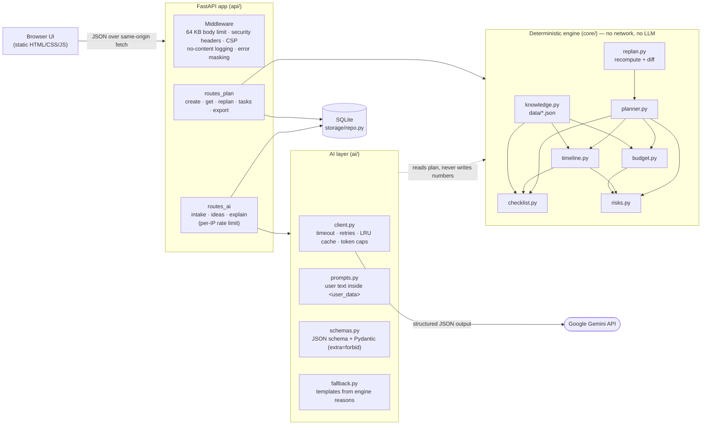

# utsav.ai architecture

utsav.ai is a **hybrid** planner. A deterministic, pure-Python engine makes every
decision about money, dates and tasks. An optional Google Gemini layer only handles
language: parsing free text, suggesting ideas and explaining the engine's
decisions. If the AI layer is off or fails, templates built from the engine's
`reason` fields take its place.

## Boundaries

| Layer | May import | Must not import | Enforced by |
|---|---|---|---|
| `core/` | stdlib, pydantic | `ai/`, `api/`, `storage/`, any network library | `tests/test_architecture.py` |
| `ai/` | `core/`, `config`, `google-genai` | `api/`, `storage/` | review |
| `storage/` | `core/models` | `ai/`, `api/` | review |
| `api/` | everything | — | — |

## Decision table (engine rules)

| Rule | Trigger | Effect | Reason shown to the user |
|---|---|---|---|
| Base split | Event type | % per category from `data/budget_splits.json` | "Base share for a wedding: 30% (illustrative default)" |
| Catering style | Per-guest budget vs per-currency thresholds × regional cost multiplier | plated ≥ upper threshold (not for community events); buffet between; potluck below the lower threshold (community events only; 60% of the catering share moves to contingency) | "₹4,000 per guest is at or above ₹4,000; the budget supports plated service" |
| Sound & AV | Guests > 150 | +4% `sound_av` budget line (taken pro rata from the others) and a critical AV task | "200 guests (> 150) need amplified sound and AV" |
| Monsoon contingency | Outdoor/mixed setting, location matches a region, month in its monsoon months | +10 points contingency, critical weather-backup task, warning risk | "outdoor event in July, monsoon season for India (southwest monsoon)" |
| Lead-time class | Weeks until the event | comfortable ≥ 16, tight 6–16, crisis < 6; risk flag for tight/crisis | "5.9 weeks to go (< 6): crisis mode…" |
| Timeline compression | Longest template lead time > time available | All milestones scaled into the window, keeping their order; late ones flagged "book now" | "Usually done 44 weeks before a wedding; that date has passed…" |
| Crisis triage | Crisis lead time | Non-critical milestones marked optional | "crisis lead time: optional, skip if it competes with critical items" |
| Late categories | Milestone already late | Matching checklist items become critical | "usually booked earlier than the time you have left, so do it first" |
| Scale | Guest count | small < 50, medium 50–150, large > 150 → scale-specific tasks | "Standard for a large (> 150 guests) wedding" |
| Sponsorship | Community event without ticket revenue | Critical sponsorship task + info risk | "No ticket revenue: the budget must be covered by sponsors or grants" |
| Dietary | Any dietary flag | Catering notes + critical caterer brief task | "Guests need vegan, jain options" |
| Must-haves | User list | One critical task each | "You marked this as a must-have" |
| Re-plan: renegotiate | Budget cut ≥ 10% after any task is done | Critical "renegotiate booked vendors" task | "Budget dropped 20% after some vendors were booked" |
| Re-plan: capacity | Guest count grows after the venue is booked | "Confirm the venue can hold N guests" | "Guest list grew from 120 to 140 after the venue was booked" |
| Re-plan: new date | Date changes after any booking | "Tell booked vendors about the new date" | "The event date changed after some vendors were booked" |

All amounts are integer minor units; the split uses largest-remainder rounding to
whole currency units so the lines always add up to the total exactly.

## Request flow

1. `POST /api/plans` validates an `EventProfile` (Pydantic, `extra="forbid"`,
   length and range limits), runs `build_plan()`, stores the JSON in SQLite and
   returns it.
2. `POST /api/plans/{id}/replan` merges a partial profile, rebuilds, carries
   checklist progress over, adds re-plan follow-up tasks and returns a structured diff.
3. AI endpoints read the stored plan, send engine facts plus delimited user text
   to Gemini with a JSON schema, validate the reply with Pydantic, and fall back to
   templates on any failure. The explanation is also checked so that it contains
   no numbers that are not already in the plan.
